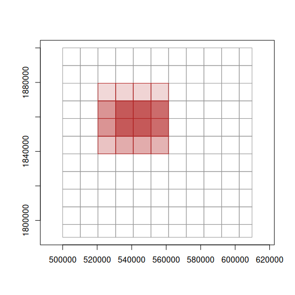

<!-- README.md is generated from README.Rmd. Please edit that file, then
     run devtools::build_readme(). The examples run live against remote
     data, so a build needs network access and the Python packages named
     in each section. -->

# xrdbi

A DBI backend for xarray. The “database” is a live Python session
(reticulate) holding an xarray object; the connection is a handle to
that object.

- tables are variables (data variables and coordinates alike)
- fields are dimensions, then non-dimension coordinates, then the
  variable
- a statement is a Python expression evaluated with `ds` and `xr` in
  scope
- `dbSendQuery()` is lazy (builds the xarray selection graph, moves no
  bytes); the tidy long-form data frame is rendered at `dbFetch()`
- `tbl(con, var)` gives a lazy dplyr table whose verbs compile to one
  Python statement
- everything else is one step away via `xr_dataset(con)`

This provides pixel-level rows on demand from anything xarray can open.
The chunk-level relation (byte ranges, encoded blobs) is deliberately a
different project; see the dbi-for-xarray design note
(gdal-r-python/dbi-xarray).

## Status

Loading xrdbi declares its core Python requirements with
`reticulate::py_require()`: xarray and netCDF4. With no Python
configured, reticulate provisions them on first use, nothing to install
by hand. Each example below declares the IO engines it needs the same
way; with your own Python (`RETICULATE_PYTHON`, a conda environment),
install those there instead. The gdalxarray engine also needs the GDAL
Python bindings, which pip cannot install: use conda or an image with
GDAL. The gdal-r-python image is the reference environment, and this
README is built live in it: every output below came from the remote data
when it was last built. See `?xrdbi` for the details.

## Example: OISST NetCDF over HTTPS

``` r
## however you do it: https://rstudio.github.io/reticulate/reference/py_require.html
##reticulate::use_python("/usr/bin/python3")
library(DBI)
library(xrdbi)
## netCDF over HTTPS: h5netcdf reads it by byte ranges through fsspec
reticulate::py_require(c("h5netcdf", "h5py", "fsspec", "aiohttp"))

eg <- "https://www.ncei.noaa.gov/data/sea-surface-temperature-optimum-interpolation/v2.1/access/avhrr/198109/oisst-avhrr-v02r01.19810901.nc"
con <- dbConnect(xarray(),
                 eg,
                 engine = "h5netcdf")  ## chunks = None by default, not reticulate::dict()

dbListTables(con)
#> [1] "anom" "err"  "ice"  "sst"  "lat"  "lon"  "time" "zlev"
dbListFields(con, "sst")
#> [1] "time" "zlev" "lat"  "lon"  "sst"

dbGetQuery(con, "ds.sst.sel(lat=slice(-56, -55), lon=slice(100, 101)).isel(time=0)") |>
  head()
#>   zlev     lat     lon                time   sst
#> 1    0 -55.875 100.125 1981-09-01 12:00:00 -0.06
#> 2    0 -55.875 100.375 1981-09-01 12:00:00 -0.14
#> 3    0 -55.875 100.625 1981-09-01 12:00:00 -0.17
#> 4    0 -55.875 100.875 1981-09-01 12:00:00 -0.11
#> 5    0 -55.625 100.125 1981-09-01 12:00:00  0.06
#> 6    0 -55.625 100.375 1981-09-01 12:00:00  0.00

dbDisconnect(con)
```

Note on `chunks`: omitting it (Python `chunks=None` for `open_dataset`)
gives lazy zarr-backed arrays and a fast connection. Passing
`chunks = reticulate::dict()` (Python `chunks={}`) wraps every variable
in dask at native storage chunking; for finely-chunked stores this can
cost minutes of task-graph construction at connect time (the ARCO ERA5
store below is 1 timestep per chunk, times 277 variables). Selection via
`sel`/`isel` is lazy either way and reads only the chunks a slab
touches, so prefer no dask for extraction, and opt in per statement for
reductions, rechunking to something sane:

``` r
dbGetQuery(con,
  "ds['2m_temperature'].chunk({'time': 744}).sel(latitude=slice(19, 18), longitude=slice(73, 74)).mean('time')")
```

Beware that the default differs by open function: `open_dataset`
defaults to `chunks=None` (no dask), `open_zarr` defaults to
`chunks='auto'` (dask). If you connect with `open = "open_zarr"`, pass
`chunks = reticulate::py_none()` explicitly to get the fast path.

## Example: ARCO ERA5 (zarr v3, anonymous GCS)

``` r
reticulate::py_require(c("zarr", "gcsfs"))
era <- "gs://gcp-public-data-arco-era5/ar/full_37-1h-0p25deg-chunk-1.zarr-v3"
con <- dbConnect(xarray(),
                 era,
                 engine = "zarr",
                 storage_options = reticulate::dict(token = "anon"))

con
#> <XarrayConnection>
#>   dsn: gs://gcp-public-data-arco-era5/ar/full_37-1h-0p25deg-chunk-1.zarr-v3
#>   dims: time: 1323648, latitude: 721, longitude: 1440, level: 37
#>   vars: 100m_u_component_of_wind, 100m_v_component_of_wind, ... (273 total)

str(dbListTables(con))
#>  chr [1:277] "100m_u_component_of_wind" "100m_v_component_of_wind" ...
dbListFields(con, "100m_u_component_of_wind")
#> [1] "time"                     "latitude"                
#> [3] "longitude"                "100m_u_component_of_wind"

## dataset attributes are one expression away
dbGetQuery(con, "ds.attrs['valid_time_start']")
#>        value
#> 1 1940-01-01
```

Label-based `slice` follows the order of the coordinate, and ERA5
latitude runs descending (90 down to -90). So this selects the empty
interval and returns zero rows, with a hint:

``` r
dbGetQuery(con,
  "ds['100m_u_component_of_wind'].sel(latitude=slice(18, 19), longitude=slice(73, 74), time='1980-01-01')")
#> xrdbi: 'latitude' selected nothing: this coordinate is DESCENDING (90.0 .. -90.0) and label slices follow coordinate order; try slice(hi, lo)
#> [1] time                     latitude                 longitude               
#> [4] 100m_u_component_of_wind
#> <0 rows> (or 0-length row.names)
```

Inspect the coordinate (coordinates are tables too), then slice in its
order:

``` r
dbGetQuery(con, "ds.latitude.isel(latitude=slice(0, 5))")
#>   latitude
#> 1    90.00
#> 2    89.75
#> 3    89.50
#> 4    89.25
#> 5    89.00

u <- dbGetQuery(con,
  "ds['100m_u_component_of_wind'].sel(latitude=slice(19, 18), longitude=slice(73, 74), time='1980-01-01')")
dim(u)
#> [1] 600   4
head(u)
#>         time latitude longitude 100m_u_component_of_wind
#> 1 1980-01-01    19.00     73.00               -0.5576082
#> 2 1980-01-01    19.00     73.25               -0.2125518
#> 3 1980-01-01    19.00     73.50                0.8037959
#> 4 1980-01-01    19.00     73.75                2.3964324
#> 5 1980-01-01    19.00     74.00                3.7569399
#> 6 1980-01-01    18.75     73.00               -0.2851481
```

Longitude here is 0..360 ascending, so `slice(73, 74)` is fine as-is. A
quoted date string on `time` selects the whole day.

## dplyr

`tbl(con, var)` is lazy: verbs accumulate, nothing touches Python until
`collect()`, and `show_query()` prints the one statement that will run.
Filters on dimensions push down to `.sel()`, oriented to the
coordinate’s direction, so the descending-latitude gotcha above
dissolves. Strict bounds keep the inclusive `.sel()` range and trim its
boundary with a boolean `.isel()`, so the statement stays an xarray
selection:

``` r
library(dplyr, warn.conflicts = FALSE)

u10 <- tbl(con, "100m_u_component_of_wind") |>
  filter(latitude > 18, latitude < 19, longitude >= 73, longitude <= 74,
         time >= as.POSIXct("1980-01-01", tz = "UTC"),
         time < as.POSIXct("1980-01-02", tz = "UTC"))
show_query(u10)
#> ds['100m_u_component_of_wind'].sel(latitude=slice(19, 18), longitude=slice(73, 74), time=slice('1980-01-01T00:00:00', '1980-01-02T00:00:00')).pipe(lambda a: a.isel(latitude=(a.indexes['latitude'] > 18) & (a.indexes['latitude'] < 19), time=(a.indexes['time'] < '1980-01-02T00:00:00')))
collect(u10)
#> # A tibble: 360 × 4
#>    time                latitude longitude `100m_u_component_of_wind`
#>    <dttm>                 <dbl>     <dbl>                      <dbl>
#>  1 1980-01-01 00:00:00    18.75     73                     -0.28515 
#>  2 1980-01-01 00:00:00    18.75     73.25                  -0.035991
#>  3 1980-01-01 00:00:00    18.75     73.5                    1.0485  
#>  4 1980-01-01 00:00:00    18.75     73.75                   2.7908  
#>  5 1980-01-01 00:00:00    18.75     74                      3.9434  
#>  6 1980-01-01 00:00:00    18.5      73                     -0.026132
#>  7 1980-01-01 00:00:00    18.5      73.25                  -0.19911 
#>  8 1980-01-01 00:00:00    18.5      73.5                    0.72313 
#>  9 1980-01-01 00:00:00    18.5      73.75                   2.6671  
#> 10 1980-01-01 00:00:00    18.5      74                      4.0419  
#> # ℹ 350 more rows
```

`head()` and `select()` apply in R to the fetched rows, and `head(n)`
first narrows the selection to the leading block that holds those `n`
rows, so a peek at a 1.3-million-step variable reads one chunk (the
store’s time axis starts in 1900, its data in 1940). Printing a tbl
shows the same kind of lazy preview:

``` r
t2m <- tbl(con, "2m_temperature") |>
  filter(time >= as.POSIXct("1980-01-01", tz = "UTC"))
t2m |> select(time, latitude, `2m_temperature`) |> head(3) |> show_query()
#> ds['2m_temperature'].sel(time=slice('1980-01-01T00:00:00', None)).isel(time=slice(0, 1), latitude=slice(0, 1), longitude=slice(0, 3)) 
#> # then in R: head(3) |> select(time, latitude, `2m_temperature`)
t2m |> select(time, latitude, `2m_temperature`) |> head(3) |> collect()
#> # A tibble: 3 × 3
#>   time                latitude `2m_temperature`
#>   <dttm>                 <dbl>            <dbl>
#> 1 1980-01-01 00:00:00       90           247.92
#> 2 1980-01-01 00:00:00       90           247.92
#> 3 1980-01-01 00:00:00       90           247.92

t2m |> filter(latitude < 60)
#> <tbl_xarray> 2m_temperature
#>   python: ds['2m_temperature'].sel(latitude=slice(60, None), time=slice('1980-01-01T00:00:00', None)).pipe(lambda a: a.isel(latitude=(a.indexes['latitude'] < 60)))
#>   sizes : time: 622,392, latitude:     601, longitude:   1,440
#> # A tibble: 6 × 4
#>   time                latitude longitude `2m_temperature`
#>   <dttm>                 <dbl>     <dbl>            <dbl>
#> 1 1980-01-01 00:00:00    59.75      0              275.68
#> 2 1980-01-01 00:00:00    59.75      0.25           275.84
#> 3 1980-01-01 00:00:00    59.75      0.5            275.98
#> 4 1980-01-01 00:00:00    59.75      0.75           275.96
#> 5 1980-01-01 00:00:00    59.75      1              275.91
#> 6 1980-01-01 00:00:00    59.75      1.25           275.89
#> # lazy preview of the first cells (reads at most one chunk); collect() for the full result

dbDisconnect(con)
```

Filters on data values (`filter(t2m > 300)`) need a pandas `.query()`
after rendering, so `head()` and `select()` then run in pandas too;
`show_query()` makes the split visible.

## Example: OISST daily mosaic via GDAL multidim VRT (gdalxarray engine)

Requires gdalxarray and the GDAL Python bindings (conda-forge `gdal`, or
an image with GDAL; pip alone cannot provide them). The dsn is a GDAL
multidim VRT mosaic over the full OISST daily record, published by a
scheduled pipeline; xarray opens it through the gdalxarray backend, so
every GDAL virtual filesystem and format is in reach of the same DBI
surface.

``` r
dsn <- "/vsicurl/https://projects.pawsey.org.au/aad-index/oisst/oisst-mdim.vrt"

Sys.setenv(AWS_NO_SIGN_REQUEST = "YES")
system.time({
  con <- dbConnect(xarray(), dsn, engine = "gdalxarray")
})
#>    user  system elapsed 
#>   0.651   0.154   2.263

con
#> <XarrayConnection>
#>   dsn: /vsicurl/https://projects.pawsey.org.au/aad-index/oisst/oisst-mdim.vrt
#>   dims: time: 16492, zlev: 1, lat: 720, lon: 1440
#>   vars: anom, err, ice, sst

## the most recent day in the record (a 0-d scalar renders as one row)
dbGetQuery(con, "ds.time.isel(time=-1)")
#>                  time
#> 1 2026-10-26 12:00:00

## one day of SST as tidy rows
dbGetQuery(con, "ds.sst.isel(time=-1)") |> str()
#> 'data.frame':    1036800 obs. of  5 variables:
#>  $ zlev: num  0 0 0 0 0 0 0 0 0 0 ...
#>  $ lat : num  -89.9 -89.9 -89.9 -89.9 -89.9 ...
#>  $ lon : num  0.125 0.375 0.625 0.875 1.125 ...
#>  $ time: POSIXct, format: "2026-10-26 12:00:00" "2026-10-26 12:00:00" ...
#>  $ sst : num  NaN NaN NaN NaN NaN NaN NaN NaN NaN NaN ...
```

Two lessons this dsn teaches:

Laziness defers failure as well as work. The VRT itself is public over
`/vsicurl`, but its sources are `/vsis3` paths into the NOAA bucket, so
a missing `AWS_NO_SIGN_REQUEST` errors at the first query, not at
connect (connect reads only the VRT metadata). GDAL reads configuration
from the process environment at access time, so `Sys.setenv()` works
even after the Python session is up; setting it before connecting is
still the tidy habit.

A connection is a snapshot. The pipeline behind this VRT publishes a new
day on schedule (it did so mid-session while writing this example: a
held connection kept answering with the previous day, a fresh connect
saw the new one). The rolling `oisst-mdim.vrt` always means “latest”;
pin a dated sibling (`oisst-mdim-YYYYMMDD.vrt`) when you need a
reproducible record. Icechunk makes this distinction first-class: a
readonly session at a snapshot is an AS OF query.

## Chunk maps

`xr_chunks()` maps a variable’s storage chunks, or the chunks a
selection touches, as a table: each chunk’s index range and coordinate
extent along every dimension, how many of its cells the selection reads,
and a rectangle over the two spatial dimensions with the CRS. Only
coordinates are read. Chunk shapes come from what the backend records
(zarr, netCDF, GDAL blocks via gdalxarray); `level = "shards"` maps the
shards of a sharded zarr v3 array, and curvilinear grids get the
envelope of each chunk’s 2-D longitude/latitude.

A Sentinel-2 true-colour Cloud-Optimized GeoTIFF, one 10980 x 10980 UTM
tile in 1024 x 1024 blocks, through gdalxarray (so, like the VRT above,
it needs the GDAL Python bindings):

``` r
cog <- "/vsicurl/https://sentinel-cogs.s3.us-west-2.amazonaws.com/sentinel-s2-l2a-cogs/36/Q/WD/2020/7/S2A_36QWD_20200701_0_L2A/TCI.tif"
con <- dbConnect(xarray(), cog, engine = "gdalxarray", multidim = FALSE)

blocks <- xr_chunks(con, "ds.band_data.isel(band=0)")
nrow(blocks)
#> [1] 121
table(blocks$cells)
#> 
#>  547600  757760 1048576 
#>       1      20     100

## a window: which blocks does reading it touch, and how much of each?
win <- xr_chunks(con,
  "ds.band_data.isel(band=0, y=slice(3000, 5500), x=slice(2500, 6000))")
win[, c("y_chunk", "x_chunk", "y_start", "y_stop", "x_start", "x_stop",
        "cells", "selected")] |> head()
#>   y_chunk x_chunk y_start y_stop x_start x_stop   cells selected
#> 1       2       2    2048   3072    2048   3072 1048576    41184
#> 2       2       3    2048   3072    3072   4096 1048576    73728
#> 3       2       4    2048   3072    4096   5120 1048576    73728
#> 4       2       5    2048   3072    5120   6144 1048576    63360
#> 5       3       2    3072   4096    2048   3072 1048576   585728
#> 6       3       3    3072   4096    3072   4096 1048576  1048576
nrow(win)
#> [1] 16
## the share of the cells in the touched blocks that the window uses
sum(win$selected) / sum(win$cells)
#> [1] 0.5215406
```

``` r
used <- win$selected / win$cells
plot(blocks$geometry, border = "grey60")
plot(win$geometry, add = TRUE, border = "firebrick",
     col = rgb(178, 34, 34, alpha = 255 * (0.15 + 0.6 * used),
               maxColorValue = 255))
```



``` r
dbDisconnect(con)
```

The touched blocks are shaded by how much of each the window uses: the
interior blocks are read whole, the edge blocks partly.

## Connect forms

Exactly one of `dsn`, `builder`, `object`.

A string that xarray can open (as above), with the open function
selectable via `open =` (“open_dataset” default, also “open_zarr”,
“open_mfdataset”, “open_datatree”) and keyword arguments passed through.

A builder function, for anything that takes more than one call (icechunk
sessions, virtualizarr, combining sources):

``` r
con <- dbConnect(xarray(), builder = function(xr) {
  ic <- reticulate::import("icechunk", convert = FALSE)
  repo <- ic$Repository$open(ic$s3_storage(
            bucket = "aad-index", prefix = "rema-v2",
            region = "ap-southeast-2", anonymous = TRUE))
  session <- repo$readonly_session("main")
  xr$open_zarr(session$store, consolidated = FALSE)
})
```

Adopt an object already built in the session:

``` r
reticulate::py_run_string(paste(
  "import xarray, numpy",
  "myds = xarray.Dataset({'v': (('y', 'x'), numpy.arange(6.).reshape(2, 3))},",
  "                      coords={'y': [10, 20], 'x': [1, 2, 3]})",
  sep = "\n"))
obj <- dbConnect(xarray(), object = reticulate::py_eval("myds", convert = FALSE))
dbGetQuery(obj, "ds")
#>    y x v
#> 1 10 1 0
#> 2 10 2 1
#> 3 10 3 2
#> 4 20 1 3
#> 5 20 2 4
#> 6 20 3 5
dbDisconnect(obj)
```

## Verbs and semantics

Continuing with the OISST VRT connection:

``` r
## structured spec compiles to the same python string (inspect it, log it)
q <- xr_query(vars = "sst",
              sel  = list(lat = c(-56, -55), lon = c(100, 101)),
              isel = list(time = 0))
q
#> [1] "ds['sst'].sel(lat=slice(-56, -55), lon=slice(100, 101)).isel(time=0)"
dbGetQuery(con, q) |> head(3)
#> Error:
#> ! connection is closed

## lazy send, paginated fetch
res <- dbSendQuery(con, "ds.sst.isel(time=0)")
#> Error:
#> ! connection is closed
dbFetch(res, n = 3)
#> Error in `h()`:
#> ! error in evaluating the argument 'res' in selecting a method for function 'dbFetch': object 'res' not found
dbFetch(res, n = 3)
#> Error in `h()`:
#> ! error in evaluating the argument 'res' in selecting a method for function 'dbFetch': object 'res' not found
dbClearResult(res)
#> Error in `h()`:
#> ! error in evaluating the argument 'res' in selecting a method for function 'dbClearResult': object 'res' not found

## whole-variable reads are guarded against accidental terabyte renderings;
## move the line with options(xrdbi.max_cells = ), or pass force = TRUE
dbReadTable(con, "sst")
#> Error:
#> ! connection is closed

## drop down whenever the veneer is in the way
ds <- xr_dataset(con)
#> Error:
#> ! connection is closed
str(reticulate::py_to_r(ds$sst$attrs))
#> Error:
#> ! object 'ds' not found
```

A result renders as the tidy long form, exactly as xarray’s
`to_dataframe().reset_index()` would give it: one row per cell, every
coordinate as a column (including scalars like `zlev` and N-D
coordinates, broadcast), in C order over the dimensions. xrdbi builds it
in R: only the values cross from Python, and the coordinate columns are
repeated with `rep()`, so ten million rows arrive in about half a second
and `dbFetch(n = )` builds only the rows asked for. Types arrive as R
types: datetimes as POSIXct tagged UTC (or their own zone, if they have
one), timedeltas as `difftime`, strings, bytes and non-standard calendar
dates (cftime) as character, categoricals as factors, geometry (the
geometry coordinate of an xvec vector data cube) as `wk::wkb` carrying
its CRS, and missing values as `NA`. Dimension coordinates render as a
single column of their values; scalar results as a one-cell frame. The
array is a rendering format; so is the data frame.

Note `isel` in `xr_query()` uses zero-based Python indices: the function
interpolates values into Python source and does not translate. The
compiled expression is the contract.

`dbBegin`/`dbCommit`/`dbRollback` error for now; the intended mapping is
icechunk sessions and commits (a readonly session at a snapshot is
literally an AS OF query).

## Not yet

- `summarise()` to xarray reductions in the dplyr layer
- chunk-aligned streaming fetch: `dbFetch(n = )` builds only the rows
  asked for, but the values of the whole selection are read at the first
  fetch
- DataTree groups as schemas (open = “open_datatree” already connects,
  but the table listing assumes a flat Dataset)
- write support (dbWriteTable as to_zarr / icechunk commit)
- registry integration: `dbConnect(xarray(), sds::dsn("oisst"))` where
  the registry row carries the open function and kwargs
- a coords on/off toggle for renderings (n-D coordinates broadcast into
  every row of a data variable, which is faithful but can be heavy)
